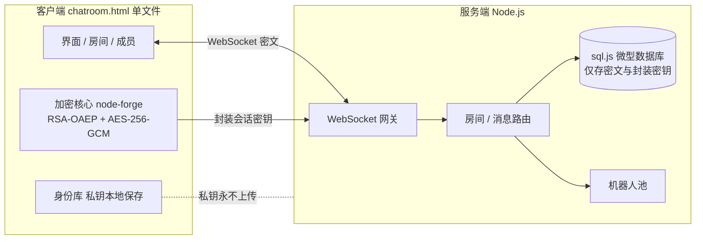

# ChatRoom · 局域网端到端加密聊天室

[](https://gitee.com/klmycjs/chatroom)
[](https://nodejs.org/)
[](./LICENSE)
[](./tools)

> 一个**零信任、自托管**的局域网聊天室：服务端不持有任何明文，私钥永不上传；客户端是一个**双击即用的单文件 HTML**，无需安装、无需联网即可在局域网内加密通信。
测试网址：https://flshw.online
---

## ✨ 功能特性

- **端到端加密**：注册用 RSA-OAEP（2048 位）非对称加密，聊天用 AES-256-GCM；每条消息的会话密钥按成员公钥单独封装，服务端只做转发、看不到明文。
- **私钥不出本机**：私钥仅保存在浏览器与本地身份文件，绝不上传；换设备通过导入身份文件（或管理员公钥）恢复。
- **单文件客户端**：`chatroom.html` 内联全部 CSS / 加密核心 / 网络层 / 应用逻辑，零外部依赖，双击即可运行。
- **多房间 + 大厅直聊**：可同时开多个房间；v5 起支持「大厅直聊」（不建房间、内容仅双方可见）。
- **在线改名 / 名称同步**：临时用户在线改昵称，服务端即时广播名称与版权信息到所有客户端。
- **正式用户身份链**：v5 起支持由管理员签名的正式身份，区分正式 / 临时 / 机器人用户。
- **身份库快切**：本地可保存多份身份，一键切换。
- **拖拽上传**：聊天框拖入图片 / 文件即上传并分享。
- **背景主题**：v5.1 预置 5 套渐变背景，支持自定义本地图片（自动压缩存储）。
- **拖拽邀请入房**：v5.2 可将成员列表中的用户直接拖到房间标签，对方弹窗确认后直接进入房间。
- **机器人系统**：内置机器人池，可自动应答，便于演示与压力测试。
- **跨平台**：服务端 Node.js ≥ 22，Windows / Linux（x64 / ARM64）通用；提供 Ubuntu 一键部署包。

---

## 🔐 安全模型

| 环节 | 机制 |
|---|---|
| 注册 / 密钥交换 | RSA-OAEP（SHA-256），2048 位密钥对 |
| 消息加密 | AES-256-GCM，随机 IV，每消息独立会话密钥 |
| 密钥分发 | 会话密钥用**每位成员的公钥**单独封装；直聊用 AAD 命名空间隔离，防止序号重放 |
| 私钥 | 仅存浏览器 / 本地身份文件，**永不上传** |
| 服务端 | 只转发密文与封装后的密钥，不持有明文、不托管私钥 |
| 管理员 | 首次启动生成管理员密钥对与初始口令，登录后强制改密并导入管理员公钥 |

---

## 🏗 架构概览



客户端负责全部加解密；服务端 `Hub` 仅做路由与持久化（密文），`sql.js` 数据库不保存任何明文。

---

## 📁 目录结构

| 路径 | 说明 |
|---|---|
| `server/` | 服务端（Node.js，CommonJS）。`src/main.js` 为入口 |
| `server/public/chatroom.html` | **已构建的单文件客户端**（由 `tools/build-client.js` 生成，开箱即用） |
| `server/public/welcome.html` | 下载页与使用说明 |
| `client/src/` | 客户端源码（`index.html` / `style.css` / `app.js` / 加密模块） |
| `shared/protocol.js` | 客户端与服务端共享的协议常量（双份同步） |
| `vendor/` | 构建时内联的 `node-forge`、`sql-wasm.wasm` |
| `tools/` | 构建、测试、打包脚本（`build-client.js` / `smoke-*.js` / `package-server.js` …） |
| `docs/` | 需求、架构、加密设计、部署、变更说明等 17 份文档 |
| `dist/` | 服务器部署包（tar.gz / zip，**不入库**） |

> `server/node_modules/`、`server/data/`（含私钥与数据库）、`logs/`、`dist/`、`client/dist/` 均已在 `.gitignore` 中排除，仓库保持干净、无敏感数据。

---

## 🚀 快速开始（本地运行）

```bash
# 1. 安装服务端依赖（需要 Node.js ≥ 22）
cd server
npm install

# 2. 启动服务端（首次启动生成服务器密钥对 + 管理员密钥对，并打印初始口令）
node src/main.js
# 或指定端口： node src/main.js --port 8081

# 3. 浏览器打开客户端
#    http://localhost:8080/            <- 聊天客户端
#    http://localhost:8080/welcome     <- 下载页与使用说明
#    http://localhost:8080/admin       <- 管理页面（需登录）
```

启动后控制台会打印：

```
  客户端访问地址:  http://192.168.0.104:8080/     [WLAN]
  服务端管理界面:  http://127.0.0.1:8080/admin
  公钥指纹:       xxxxxxxxxxxxxxxx  (请与客户端核对)
  管理员初始口令: xxxxxxxxxxxxxxxx
```

**首次进入**：在客户端用昵称注册即可生成你的身份；**首次管理员登录**的口令在控制台 / `journalctl -u chatroom` 中查看，登录后请立即改密并导入管理员公钥。`/welcome` 页面提供单文件客户端下载与文件哈希、公钥指纹核对。

---

## 🖥 跨平台运行

```bash
# Windows
cd server && npm install && node src/main.js

# Linux（Debian / Ubuntu / CentOS，x64 或 ARM64）
# 需 Node.js ≥ 22，参考 docs/16-Ubuntu部署说明.md 的三种安装方式
node src/main.js

# 放行端口（Linux）
sudo ufw allow 8080/tcp
# 或 firewalld: sudo firewall-cmd --add-port=8080/tcp --permanent && sudo firewall-cmd --reload
```

---

## 📦 服务器部署包（Ubuntu）

`dist/` 下提供双格式部署包（含 `node_modules`，离线可用）：

- `chatroom-server-v5.0.0.tar.gz`
- `chatroom-server-v5.0.0.zip`

内含 `deploy/install-ubuntu.sh` 一键安装与 `deploy/chatroom.service`（systemd 单元），部署文档见 `docs/16-Ubuntu部署说明.md`。三步走：

```bash
tar -xzf chatroom-server-v5.0.0.tar.gz -C /tmp
cd /tmp/chatroom-server
sudo bash deploy/install-ubuntu.sh        # 自动装好 systemd 服务并验收
```

脚本自动完成：Node ≥ 22 检查 → 创建 `chatroom` 系统用户 → 部署到 `/opt/chatroom-server` → 生成 systemd 单元（`LimitNOFILE=65535`、`ProtectSystem=strict`、数据外置 `/var/lib/chatroom`、日志 `/var/log/chatroom`）→ 开机自启 + 健康检查。

---

## 🛠 开发指南

```bash
# 修改客户端源码后，重新生成单文件客户端（输出到 server/public 与 client/dist）
node tools/build-client.js
# 单文件约 420 KB，6 段内联脚本，零外部资源

# 全量回归测试（需服务端处于运行状态）
node tools/smoke-test.js              # 基础冒烟       24 项
node tools/verify-crypto-interop.js   # 加解密互通与静态能力检查  60 项
node tools/smoke-v3.js                # v3 回归        51 项
node tools/smoke-v4.js                # v4 回归        40 项
node tools/smoke-v5.js                # v5 / v5.1 / v5.2 回归  57 项
# 合计 232 / 232 通过

# 重新打包服务器端部署包（双格式）
node tools/package-server.js --zip

# 校验所有源文件的统一版权头
node tools/stamp-copyright.js --check
```

---

## 🧰 技术栈

- **服务端**：Node.js ≥ 22（CommonJS）、`ws`（WebSocket）、`node-forge`（RSA / PKCS、PBKDF2）、`sql.js`（SQLite WASM，仅存密文）
- **客户端**：原生 JavaScript（无任何框架），`node-forge` + `sql.js` 由 `vendor/` 内联进单文件 HTML；加密、协议、UI 全自研
- **传输**：WebSocket（文本信封 JSON），HTTP 仅用于静态资源与下载

---

## 📚 文档索引

`docs/` 目录包含完整设计与变更记录：

| 文档 | 内容 |
|---|---|
| `00-架构决策记录.md` | ADR 决策日志 |
| `01-需求规格.md` | 功能需求规格 |
| `02-功能思维导图.svg` / `03-系统框架图.svg` | 功能与系统框架图 |
| `04-第三方库清单.md` | 依赖与体积清单 |
| `06-加密协议设计.md` / `07-通信接口规范.md` | 加密与接口协议 |
| `09-服务端组件清单与跨平台部署.md` | 服务端组件与部署 |
| `11-性能评估与容量规划.md` | 性能与容量 |
| `12-语言与架构选型建议.md` | 技术选型 |
| `14-v4变更说明.md` / `15-v5变更说明.md` | 版本变更说明 |
| `16-Ubuntu部署说明.md` | Ubuntu 部署完整手册 |

---

## 🗒 更新日志

- **v5.2** — 成员拖拽邀请入房（对方弹窗确认后直接进入房间）。
- **v5.1** — 客户端 UI 增量：预置 5 套背景主题 + 自定义图片、房间切换与成员列表样式优化。
- **v5** — 大厅直聊（AAD 命名空间隔离）、在线改名、名称/版权即时同步、正式用户身份链、多房间同开、身份库快切、拖拽上传。
- **v4** — 加密协议强化与多端互通。
- **v3** — 基础端到端加密聊天室。

---

## 📄 许可证

本项目以 **MIT 许可证**开源，详见 [LICENSE](./LICENSE)。

版权归属：CJS flshw@126.com
